# reviewproof

reviewproof keeps a review ledger for each pull request or merge request and refuses review
claims that cannot be checked. It refuses a finding without a source, a withdrawal without
evidence, a verdict before the gates have finished and every changed file has been read, and a
post without a named person. It does not review code and calls no model: an agent or a person does
the review, reviewproof does the bookkeeping. It was built for AI-assisted review over several
rounds, and works for people too.

Site: https://vannt-dev.github.io/reviewproof/ · npm: [reviewproof](https://www.npmjs.com/package/reviewproof)

<picture>
  <source media="(prefers-color-scheme: dark)" srcset="https://raw.githubusercontent.com/vannt-dev/reviewproof/main/docs/diagrams/overview-dark.svg">
  
</picture>

## Prerequisites

- Node >= 22.18 for the CLI. Claude Code itself does not need Node; only this tool does.
- git.
- GitHub: the `gh` CLI, logged in (`gh auth login`).
- GitLab: a `GITLAB_TOKEN` environment variable (a token with `api` scope). reviewproof calls the
  GitLab API itself; `glab` is not needed.

Works on Windows, macOS and Linux.

## Install

```sh
npm i -g reviewproof
```

As a Claude Code plugin (adds the Read and shell hooks and the `review-round` skill):

```text
/plugin marketplace add vannt-dev/reviewproof
/plugin install reviewproof@reviewproof
```

## One round

Run inside a checkout that is at the head of the pull request.

```sh
reviewproof start o/r#12                  # round 1 (a URL or gitlab:g/r!7 also work)
reviewproof diff                          # prints the round diff, counts the files read
reviewproof gate run tests -- npm test    # no shell; the log is kept, a rerun is attempt 2
reviewproof gate ci "CI result"           # or take a finished CI check of the head as the gate
reviewproof gate skip e2e --reason "needs a staging server"
reviewproof add findings.json             # sourced findings, linted
reviewproof status                        # what still blocks a verdict
reviewproof verdict not-yet --summary "Two findings open; tests pass."
reviewproof draft                         # writes the note and prints it
reviewproof post --approved-by alice      # the person runs this, never the agent
```

The draft holds the verdict, a table of the round's findings with each finding's body below it,
the carried findings with their status, the gates and the read coverage.

A gate's evidence is for the round's head. Each attempt records the commit the checkout was at and
whether tracked files had uncommitted changes; an attempt at another commit, or with changes, does
not count, and `gate run` says so. The verdict then asks for a new run (`gate test ran at 1a2b3c4,
not at the round's head 5d6e7f8: run it again`). Attempts are only added, never replaced: the draft
shows each gate's last result, the commit it ran at and the attempts that failed before it
(`- test: pass at 5d6e7f8, 2 attempts (attempt 1 failed)`).

### CI checks as gates

`gate ci <check>` records a check of the pull request instead of running a command here (GitHub
only; it reads through `gh` and writes nothing to GitHub). It asks for the check runs and commit
statuses of the round's head, finds the one with that name (exactly, else ignoring case; a missing
or unclear name lists the names there) and stores its name, conclusion, commit, run link and start
and end times as a gate attempt. No log is kept.

```sh
reviewproof gate ci lint                     # gate "lint" from the check "lint"
reviewproof gate ci "CI result" --as tests   # gate "tests" from the check "CI result"
reviewproof gate ci --all                    # every finished check of the head, one gate each
```

- `success` is a pass. `failure`, `cancelled`, `timed_out` (and a status `error`) are a fail, and
  the command exits 1.
- A check that is queued or running is refused (`is not finished yet`): run the command again
  later. A check that ended as `skipped`, `neutral` or anything else is refused too, as it shows
  nothing either way. `--all` leaves these out and names them.
- The check must have run on the round's head. One that ran on another commit is refused, the same
  way a local run at another commit does not count.
- When several runs share a name (a job that runs on push and on pull_request), the gate passes
  only when all of them passed.
- The gate is named after the check, with every run of other characters than letters, digits, `.`,
  `_` and `-` turned into one `-` (`CI result` becomes `CI-result`); that is the name to put in
  `requiredGates`. `--as NAME` picks the gate name instead.

The draft shows such a gate with its run link:

```text
- ci: tests (check `CI result`) pass at 5d6e7f8 (https://github.com/o/r/actions/runs/1/job/2), 1 attempt
```

`post` sends the draft as a comment, reads it back, compares it with the draft and stores the
comment's id and URL. A pull request has one note: a later round edits the note posted before
instead of adding a comment per round, and the ledger keeps every round's note (`drafts/`). If that
note was deleted, `post` posts a new one; `post --new-comment` always does. An edited comment sends
no new notification, so use `--new-comment` when the author should hear of the round. Reopened
findings keep their reasoning in the note, since the note of their own round is replaced.

`post --inline` also puts each open finding on its line: on GitHub one review that only comments
(never approves), pinned to the round's head; on GitLab one discussion per finding. Only lines the
pull request adds can take a comment; a finding elsewhere stays in the note only, and `post` lists
it. The note always holds every finding. If the line comments fail part way, run
`post --inline` again: it adds the missing ones and never a second note.

`post` refuses when the draft file differs from the note the ledger renders (run
`reviewproof draft` again), and it refuses inside Claude Code (`CLAUDECODE=1`): post from your own
terminal, not from the agent. After the author pushes, run `start` again: every finding still open
needs a status before the next verdict. A new round diffs from the head of the most recent round
that has a verdict, so files from a round nobody finished are still in it; with no earlier verdict
it diffs from the first round's start (the merge-base when that round began); `start --full` diffs
from the current merge-base.

```sh
reviewproof mark F1-1 verified
reviewproof mark F1-2 reopened --at src/api/client.ts:91
reviewproof mark F1-3 withdrawn --evidence "src/api/client.ts:40@3f9c2ab handles it"
```

Other commands: `read <file> [--lines a-b]` counts a file read elsewhere, `skip <file> --reason R`
leaves a changed file out of coverage, `start --force` starts a round at an unchanged head,
`start --full` diffs from the merge-base, `export --sarif [--out FILE]` writes the latest round as
SARIF 2.1.0 (to FILE, or to stdout without `--out`) for code-scanning tools.

`diff` prints at most 25000 characters per call. Files are printed in order while they fit, and
only the printed ones count as read. Files that would fit in a later call are listed on stderr:
`not shown (too long for one call): <files> — run reviewproof diff <files>`. A file whose diff alone
is larger than the budget is never printed or counted read, not even when it is the only file
asked for; stderr says `<file>: its diff is larger than one call can show; open it with Read in
parts (each part is recorded) or record what you read with reviewproof read <file> --lines a-b`.
Gate names start with a letter or digit and then hold only letters, digits, `.`, `_` and `-` (for example `test-unit`, not
`test:unit` or `../x`).

### Findings file

```json
[
  {
    "severity": "major",
    "source": { "kind": "rule", "ref": "CONTRIBUTING.md#error-handling" },
    "at": "src/api/client.ts:88",
    "title": "Network errors are swallowed",
    "body": "The catch block returns null, which callers read as 'not found'."
  }
]
```

Severity: `blocking`, `major`, `minor`. Source kind: `rule`, `design`, `legacy`, `other`; `ref` must
not be empty. `at` is checked at the round's head: the file must exist and the line must be inside it.
Withdrawal evidence must contain a `file:line@sha` location or a URL.

## Backtest

`backtest` replays a review on a pull request that is already merged and compares its findings with
what people commented there (GitHub only; it only reads). It tells how much of a real review the
reviewer, an agent or a person, would have caught.

```sh
reviewproof backtest o/r#12                          # 1. the head to review, nothing of the comments
reviewproof backtest o/r#12 --findings findings.json # 2. the comparison
```

1. Without `--findings` it names the commit to review: the head of the first human review (the
   earliest review or line comment by someone other than the author and not a bot), else the merged
   head. It prints the fetch and diff commands and no comment, so the replay stays blind. Review that
   commit in a checkout of the repository and write the findings as for `add`.
2. With `--findings` the findings are checked at that commit like `add` checks them, then compared
   with the people's line comments (thread replies left out): a finding in the same file within
   `--near` lines (default 3) catches a comment, a comment on a whole file is caught by any finding
   in it. It prints caught (with the share), missed, extra (findings near no comment: new points or
   noise, a person judges) and the review bodies, which have no line and are judged by hand.

```text
backtest o/r#12 at 1a2b3c4: the head of the first human review (alice, 2026-11-02); lines within 3
caught 3 of 4 line comments (75%)
missed:
  - src/api/client.ts:91 alice: retries never stop on a 4xx (https://github.com/o/r/pull/12#discussion_r5)
```

Each miss is appended once (by its link) to a misses file for the next review to learn from:
`<ledger home>/<host>/<owner>/<repo>/misses.md`, committed in the ledger, or the file given with
`--misses FILE`. A comment made on a later commit than the replayed one may point a few lines off;
`--near` widens the match.

## Parallel reviews

The ledger is locked per pull request while a command changes it, so commands run at the same
time are safe: none loses another's change, and a gate's log is never overwritten.

- Start each gate as its own background command right after `start`, and review while they run.
  `status` shows a gate still running as missing.
- Split a large diff among helper agents: their Reads count, each recorded with the agent's id.
  Once a helper has read for a round, a `major` or `blocking` finding is accepted only on a line
  the main session has read itself (its own Read, the lines `diff` printed, or `read`): `add` and
  `mark ... reopened` name the line and refuse. A `minor` finding is taken on the helper's word.
- Several pull requests: one checkout (a git worktree) and one agent per pull request; each pull
  request has its own ledger, so they never wait for each other.

## Config

`.reviewproof.json` in the reviewed checkout, else `config.json` in the ledger home. The first file
found is used whole; a missing or wrong-typed key falls back to its default, but a file that is
not valid JSON is an error.

| Key | Default | Meaning |
| --- | --- | --- |
| `requiredGates` | `[]` | gate names that must have a finished run before a verdict |
| `skip` | `["package-lock.json", "pnpm-lock.yaml", "yarn.lock", "**/*.snap"]` | changed files left out of coverage |
| `hedgeWords` | `["probably", "seems", "might", "maybe", "likely"]` | words refused in a verdict summary |
| `evidence` | `[]` | evidence files (screenshots, reports) that must be newer than the code they show (see Stale evidence) |
| `evidenceCovers` | `["**"]` | the files whose change makes the evidence stale |

### Stale evidence

A screenshot or a test report shows the code as it was when it was made. With `evidence` set
(for example `["docs/evidence/**", "*.png"]`), reviewproof looks at the pull request's own commits
(first parent, from the merge-base; what a merge of the base branch brought in does not count). An
evidence file the pull request changed is stale when its last change is in an older commit than the
newest change to a file it covers (`evidenceCovers`, every file by default, evidence files left
out). Stale evidence blocks `verdict pass`, `status` lists it, and the draft has an Evidence section:

```text
- evidence docs/evidence/list.png was last changed at 1a2b3c4, before src/list.ts changed at 5d6e7f8: make it again at the head
```

Set `evidenceCovers` to the code the evidence shows (`["src/**"]`) so that a README change after
the screenshots does not make them stale. Evidence the pull request did not change, or deleted, is
not judged.

## Ledger

`$REVIEWPROOF_HOME`, default `~/.reviewproof`, is a git repository of its own, so reviews never touch
the reviewed repository. Each verdict and each post makes one commit, and the line comments of
`post --inline` one more. You may push it to a private remote. `active.json` (this machine's checkout paths) and the `*.lock` files are git-ignored.

```text
<host>/<owner>/<repo>/<number>/
  ledger.json                    # schemaVersion 1
  logs/round-<k>/<gate>-<attempt>.log   # gate run only; a gate ci attempt has no log
  reads/round-<k>.jsonl          # one line per counted Read, diff or read
  drafts/round-<k>.md
  ledger.lock                    # held while a command changes this pull request; git-ignored
```

reviewproof never writes a token to disk. The values of `*_TOKEN` variables are replaced by `***` in
gate logs and in the command line stored for each gate attempt (`ledger.json` and the SARIF
`commandLine`), and in the check names and links that `gate ci` stores.

## Prior art

- Copilot code review, Claude Code Review, Cursor Bugbot, CodeRabbit, Greptile: carry findings across rounds, but resolve or drop them on their own.
- Reviewable, Gerrit, GitHub "Viewed": mark files reviewed, but a person declares it; nothing measures what was read.
- Lattice-Data/claude-pr-review: keeps the ledger in the PR comment.
- davdittrich/review-code: file:line plus an evidence class, SARIF output, asks before posting.
- SwiftlyAside/review-ledger: finding ids, `fix --evidence`, a local ledger, no posting.

reviewproof adds the refusals: no finding without a source, no withdrawal without evidence, no verdict
before the gates and reads are done, measured read coverage, and the posted note read back.

## Limits

- The Read hook works in Claude Code only. A Read always counts as a line range: from `offset` (default
  1) for `limit` lines (default 2000, the Read tool's own default). A Read cut short by the token limit
  counts only when Claude Code marks it `PARTIAL view`; reads through `cat` in a shell or Grep are not
  counted.
- Other agents use `reviewproof diff` and `reviewproof read`. These are declarations, not
  measurements: reviewproof records that the file was shown or that you said you read it, not that
  anyone understood it.
- On Windows a `.cmd` tool (such as `npm`) is retried through `cmd.exe`, which expands `%VAR%` in the
  arguments.
- The person posts by running `reviewproof post --approved-by <name>` in their own terminal. The
  PreToolUse guard stops this tool's `post` command only. It does not stop an agent that calls the
  GitHub or GitLab API itself (`gh api`, `curl`, ...).
- One note per pull request, edited each round. Line comments only with `post --inline` and only on
  lines the pull request adds. No approving or merging.

## License

MIT
